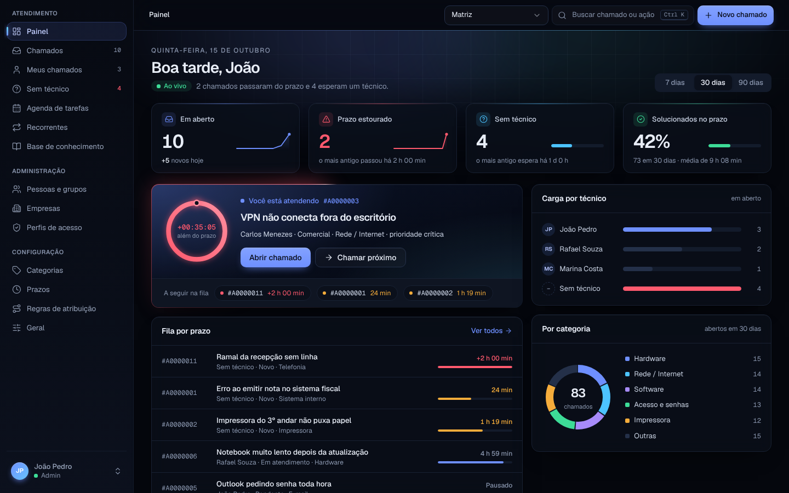
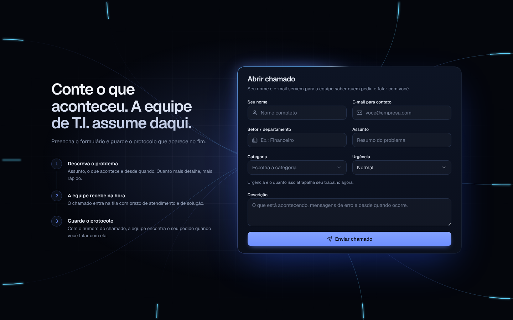
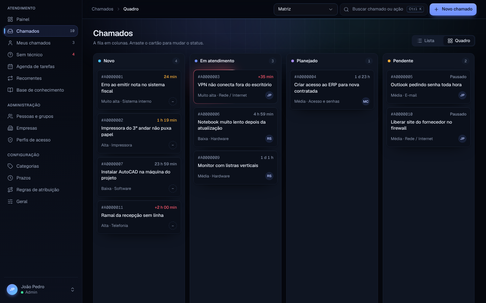
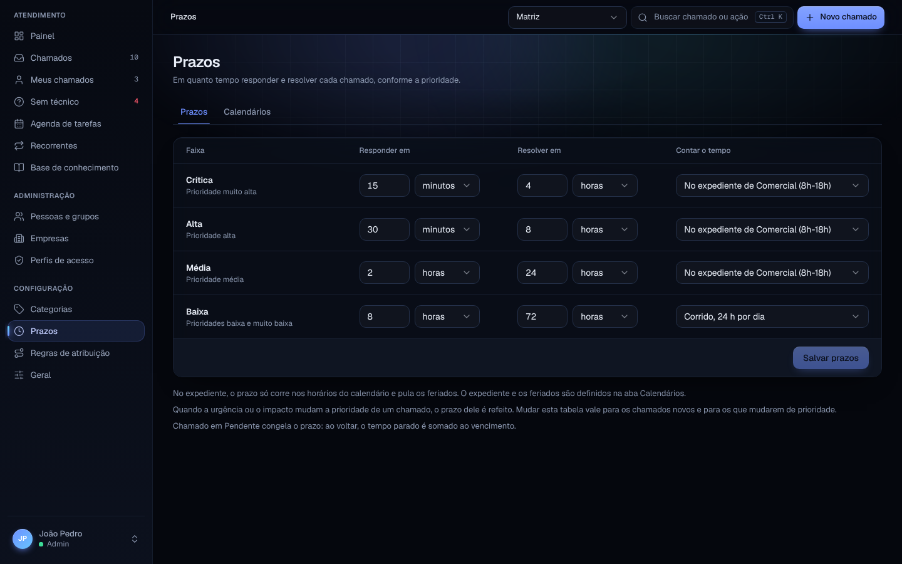
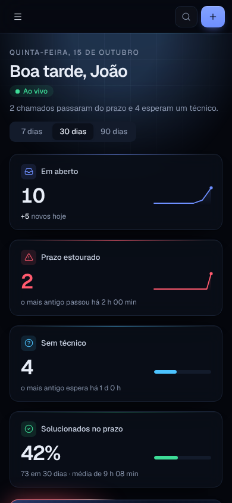
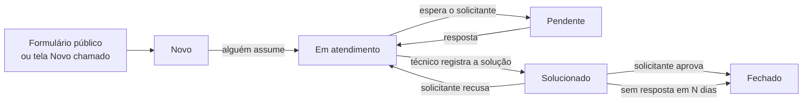
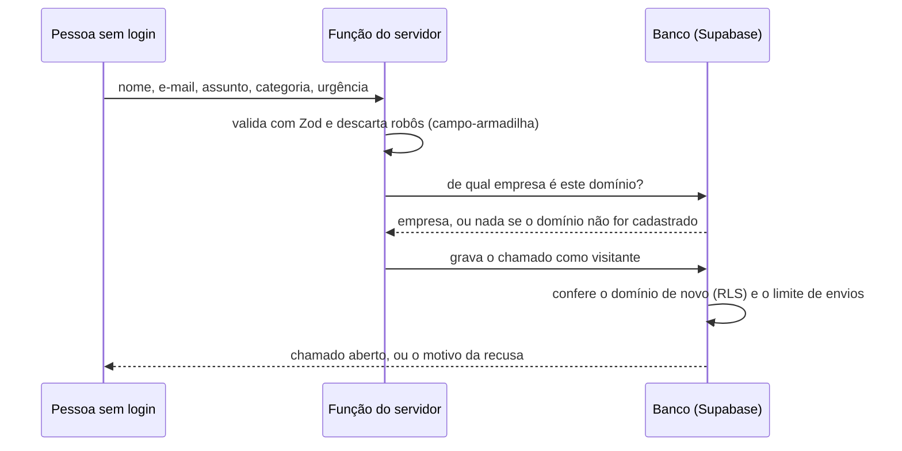
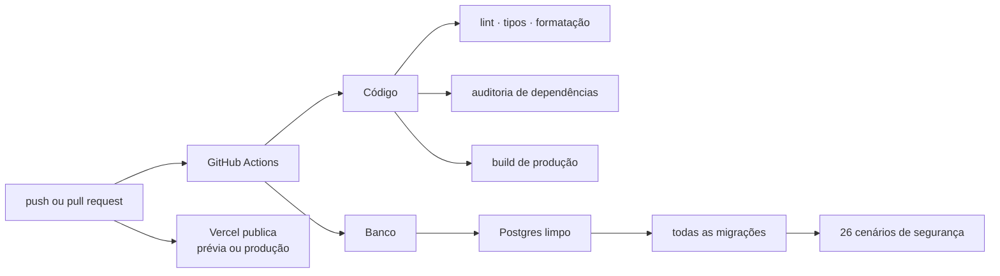

<div align="center">



# Central de Chamados

**Atendimento de T.I.** · inspirado no [GLPI](https://glpi-project.org)

Central de chamados para equipes de suporte: fila ordenada por prazo, atribuição automática, quadro de atendimento e um formulário público em que só e-mails das empresas atendidas abrem chamado. Várias empresas no mesmo sistema, cada uma isolada das outras pelo próprio banco de dados.

[](https://github.com/higornovocardoso/Central-de-Chamados/actions/workflows/verificar.yml)
[](LICENSE)

[Portfólio](https://higornovocardoso.com) · [LinkedIn](https://www.linkedin.com/in/higornovocardoso) · [GitHub](https://github.com/higornovocardoso)

</div>

---

## Sumário

- [Destaques](#destaques)
- [Capturas de tela](#capturas-de-tela)
- [Tecnologias](#tecnologias)
- [Estrutura do projeto](#estrutura-do-projeto)
- [Como funciona](#como-funciona)
- [Segurança](#segurança)
- [Rodando localmente](#rodando-localmente)
- [Qualidade e automação](#qualidade-e-automação)
- [Publicação](#publicação)
- [Licença](#licença)

## Destaques

- **Fila por prazo de verdade.** Cada prioridade tem um prazo para responder e outro para resolver, contados no horário comercial do calendário escolhido. O relógio para enquanto o chamado aguarda o solicitante, e a primeira resposta fica registrada.
- **Chamar próximo.** O painel mostra o chamado que você está atendendo, com o tempo que falta, e um botão que pega o próximo da fila pelo prazo mais apertado.
- **Formulário público fechado por domínio.** Quem não tem conta abre chamado sem login, mas só com o e-mail de uma empresa cadastrada. O domínio do e-mail decide de qual empresa é o chamado.
- **Várias empresas, cada uma no seu quadrado.** O isolamento é feito no banco (Row Level Security), não na tela: uma empresa não lê nem grava dado de outra, mesmo chamando a API direto.
- **Perfis e direitos no estilo do GLPI.** Super-Admin, Técnico, Self-Service e outros, com direito por objeto (ler, criar, editar, excluir). Ninguém concede um perfil maior que o próprio.
- **Atendimento completo.** Acompanhamentos públicos e privados, tarefas, solução com aprovação do solicitante, pedido de aprovação, anexos e histórico de tudo o que mudou.
- **Automação.** Regras de atribuição por critério, chamados recorrentes e fechamento automático, rodando no próprio banco com pg_cron.
- **Quadro de atendimento.** Os chamados em colunas por status, arrastando de uma para outra.
- **Feito para o dia a dia.** Busca rápida com `Ctrl K`, tema escuro e claro (a escolha fica salva), endereços com o nome de cada tela e layout que funciona no celular.

## Capturas de tela

| Entrar                                                                                                                                 | Abrir chamado sem login                                                                                                               |
| -------------------------------------------------------------------------------------------------------------------------------------- | ------------------------------------------------------------------------------------------------------------------------------------- |
|  |  |

| Chamados                                                                               | Quadro                                                                     |
| -------------------------------------------------------------------------------------- | -------------------------------------------------------------------------- |
|  |  |

| Chamado                                                                                      | Prazos                                                                                            |
| -------------------------------------------------------------------------------------------- | ------------------------------------------------------------------------------------------------- |
|  |  |

<p align="center">
  
</p>

## Tecnologias

| Camada             | Escolha                                                                       | Por quê                                                                                    |
| ------------------ | ----------------------------------------------------------------------------- | ------------------------------------------------------------------------------------------ |
| Framework          | [TanStack Start](https://tanstack.com/start) com TanStack Router              | Renderização no servidor, rotas tipadas por arquivo e funções de servidor sem API separada |
| Interface          | React 19, Tailwind CSS v4 e componentes do [shadcn/ui](https://ui.shadcn.com) | Componentes acessíveis do Radix, com o visual inteiro em tokens CSS                        |
| Dados no navegador | TanStack Query                                                                | Cache, recarga em segundo plano e estado de carregamento sem código repetido               |
| Banco e login      | [Supabase](https://supabase.com) (Postgres, Auth, RLS, pg_cron)               | As regras de acesso vivem no banco, então valem para a tela e para a API                   |
| Validação          | [Zod](https://zod.dev)                                                        | O mesmo esquema valida o formulário no navegador e a entrada no servidor                   |
| Build              | Vite e [Nitro](https://nitro.build)                                           | Um build só gera o estático e a função de servidor para a hospedagem                       |
| Hospedagem         | [Vercel](https://vercel.com)                                                  | Publica sozinha a cada push na `main`, com prévia a cada pull request                      |
| CI                 | GitHub Actions                                                                | Lint, tipos, formatação, auditoria de dependências, build e testes do banco a cada push    |

## Estrutura do projeto

```text
.
├── src/
│   ├── routes/                     # uma tela por arquivo (TanStack Router)
│   │   ├── __root.tsx              # documento, tema antes da primeira pintura, 404
│   │   ├── entrar.tsx              # login
│   │   ├── abrir-chamado.tsx       # formulário público, sem login
│   │   └── _authenticated/         # tudo o que exige sessão: painel, chamados, quadro…
│   ├── components/                 # AppShell (menu e topo), tabelas, diálogos, busca rápida
│   │   └── ui/                     # componentes base do shadcn/ui
│   ├── lib/
│   │   ├── prazo.ts                # cálculo do tempo restante e da ordem da fila
│   │   ├── public-tickets.functions.ts  # função de servidor do formulário público
│   │   ├── users.functions.ts      # criar, editar e excluir contas (servidor)
│   │   ├── permissions.ts          # direitos do usuário logado
│   │   ├── theme.ts                # tema escuro e claro, com a transição em círculo
│   │   └── enderecos-antigos.ts    # endereços antigos que redirecionam para os novos
│   ├── integrations/supabase/      # clientes do navegador e do servidor, tipos do banco
│   └── server.ts                   # entrada do servidor: cabeçalhos de segurança e erros
├── supabase/
│   ├── migrations/                 # o esquema inteiro, fase a fase, com as políticas de acesso
│   └── tests/                      # testes de isolamento e de segurança, em SQL
├── scripts/testar-banco.sh         # recria o banco do zero e roda os testes
├── docs/                           # capturas usadas neste README
├── .github/workflows/              # verificação automática (GitHub Actions)
└── vite.config.ts                  # build, redirecionamentos e cache do estático
```

## Como funciona

### O caminho de um chamado



Ao nascer, o chamado passa por uma sequência de gatilhos no banco, sempre na mesma ordem:

1. **Proteção da abertura.** Para quem não é da equipe, o banco zera o que é do sistema (data, técnico, fechamento) e limita o tamanho dos textos.
2. **Regras de atribuição.** Definem técnico, grupo ou categoria conforme os critérios cadastrados.
3. **Prioridade.** Sai do cruzamento entre a urgência (quem abriu informa) e o impacto (quem atende ajusta).
4. **Prazos.** Calculados a partir da abertura, no calendário da empresa, e recalculados se a prioridade mudar.
5. **Pausa e primeira resposta.** O relógio para em "Pendente", e a primeira resposta é registrada quando o chamado sai de Novo ou recebe um acompanhamento público da equipe.

### Formulário público



A conferência do domínio acontece duas vezes de propósito. A chave pública do Supabase vai no navegador, então qualquer pessoa pode tentar gravar direto na API. A segunda conferência, feita pelo banco, é a que vale.

## Segurança

O sistema parte do princípio de que a API é pública: tudo o que a tela impede, o banco também impede.

- **Isolamento entre empresas** por Row Level Security em todas as tabelas, inclusive nas que pendem do chamado (acompanhamentos, soluções, aprovações, anexos).
- **Campos do sistema protegidos.** Quem não é da equipe não escolhe data de abertura, técnico, prioridade travada nem fechamento.
- **Limite de envios** no formulário público: 5 chamados por e-mail e 60 no total a cada 10 minutos.
- **Sem escalada de privilégio.** Um perfil só pode ser concedido por quem já tem todos os direitos dele. Senha, e-mail e exclusão de conta passam por uma checagem no banco: quem cuida das pessoas de uma empresa não mexe na conta de um administrador nem de outra empresa.
- **Chave administrativa só no servidor.** A `SUPABASE_SERVICE_ROLE_KEY` nunca vai para o navegador e é usada só nas funções de conta, depois da checagem de direito.
- **Cabeçalhos de segurança** em toda resposta: Content-Security-Policy, HSTS, `X-Frame-Options: DENY`, `nosniff`, `Referrer-Policy` e `Permissions-Policy`.
- **Testado a cada push.** `supabase/tests/` tem 26 cenários que tentam pela API o que a tela não oferece (ler outra empresa, forjar campos, promover a si mesmo) e exigem que o banco recuse.

Encontrou uma falha? Abra uma [issue](https://github.com/higornovocardoso/Central-de-Chamados/issues) sem detalhes de exploração e eu entro em contato.

## Rodando localmente

Pré-requisitos: [Node.js](https://nodejs.org) 22 e um projeto no [Supabase](https://supabase.com).

```bash
git clone https://github.com/higornovocardoso/Central-de-Chamados.git
cd Central-de-Chamados
npm install
cp .env.example .env    # preencha com os dados do seu projeto Supabase
npm run dev             # abre em http://localhost:8080
```

As migrações de `supabase/migrations/` criam o banco inteiro. Aplique na ordem dos nomes, pelo [Supabase CLI](https://supabase.com/docs/guides/cli) (`supabase db push`) ou colando cada arquivo no SQL Editor do painel. O primeiro usuário cadastrado vira administrador e cadastra o resto pela tela Pessoas.

### Variáveis de ambiente

Os valores saem do painel do Supabase, em Project Settings > API.

| Variável                        | Onde é lida | O que é                                                      |
| ------------------------------- | ----------- | ------------------------------------------------------------ |
| `SUPABASE_URL`                  | Servidor    | URL do projeto                                               |
| `SUPABASE_PUBLISHABLE_KEY`      | Servidor    | Chave pública (publishable ou anon)                          |
| `SUPABASE_SERVICE_ROLE_KEY`     | Servidor    | Chave administrativa. Só para criar, editar e excluir contas |
| `VITE_SUPABASE_URL`             | Navegador   | A mesma URL, embutida no código enviado ao navegador         |
| `VITE_SUPABASE_PUBLISHABLE_KEY` | Navegador   | A mesma chave pública, embutida no código                    |

Tudo o que começa com `VITE_` fica visível para qualquer visitante. Só a chave pública pode ir ali; a `SUPABASE_SERVICE_ROLE_KEY` nunca.

### Comandos

| Comando             | O que faz                                            |
| ------------------- | ---------------------------------------------------- |
| `npm run dev`       | Servidor de desenvolvimento com recarga automática   |
| `npm run build`     | Build de produção para a Vercel                      |
| `npm run lint`      | ESLint com as regras do Prettier                     |
| `npm run typecheck` | Verificação de tipos do TypeScript                   |
| `npm run format`    | Formata o projeto inteiro com o Prettier             |
| `npm run test:db`   | Recria o banco do zero e roda os testes de segurança |

## Qualidade e automação



O teste do banco roda num Postgres comum, com um modelo mínimo do Supabase (`supabase/tests/stubs/`). Para rodar na sua máquina, com um Postgres 16 e o stub do pg_cron copiado para a pasta de extensões do servidor:

```bash
PGHOST=127.0.0.1 PGUSER=postgres npm run test:db
```

## Publicação

A Vercel publica sozinha: cada push na `main` vai para produção e cada pull request ganha um endereço de prévia. As variáveis de ambiente ficam no projeto da Vercel, em Settings > Environment Variables, e só passam a valer no build seguinte.

Mudança no banco não sobe com o código. Cada migração nova é aplicada no Supabase (CLI ou SQL Editor) antes de o código que depende dela ir para a `main`.

## Licença

O código está sob a licença [MIT](LICENSE). Pode estudar, copiar e adaptar para a sua equipe.

---

<div align="center">
Feito por <a href="https://www.linkedin.com/in/higornovocardoso">Higor Cardoso</a> · Garopaba, SC
</div>
