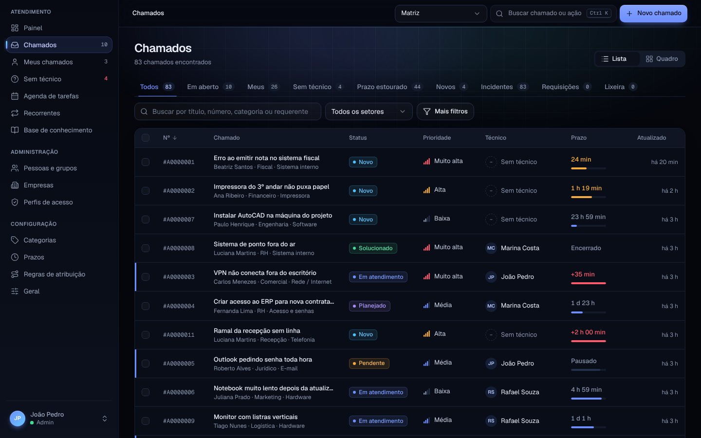
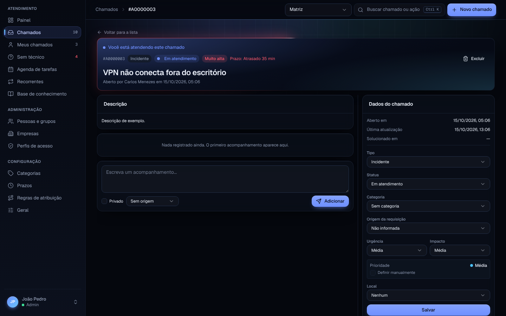
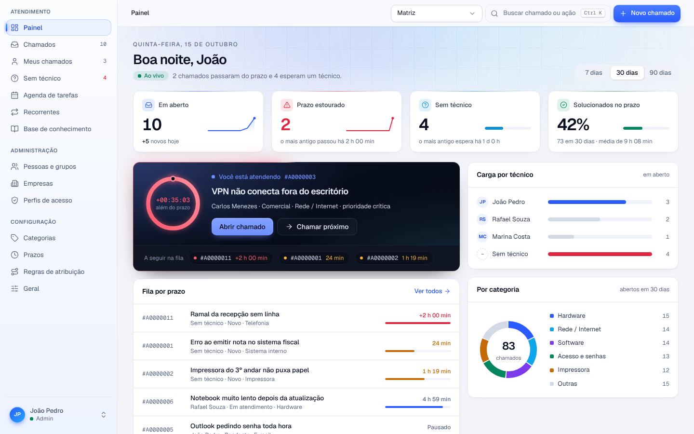
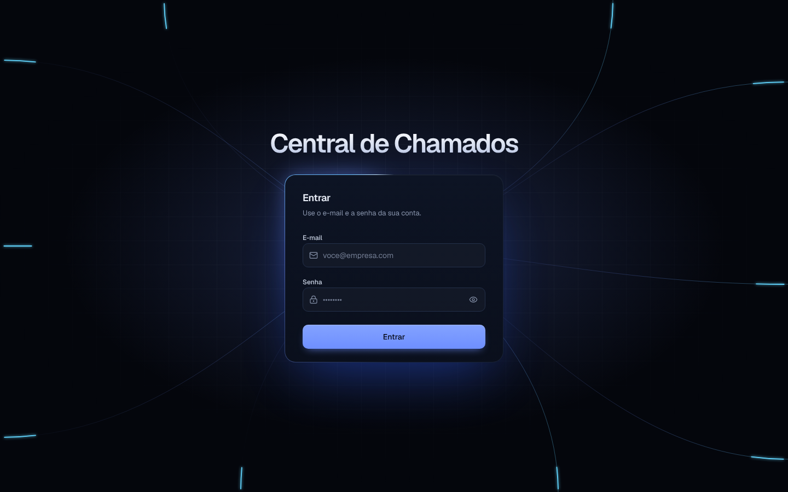
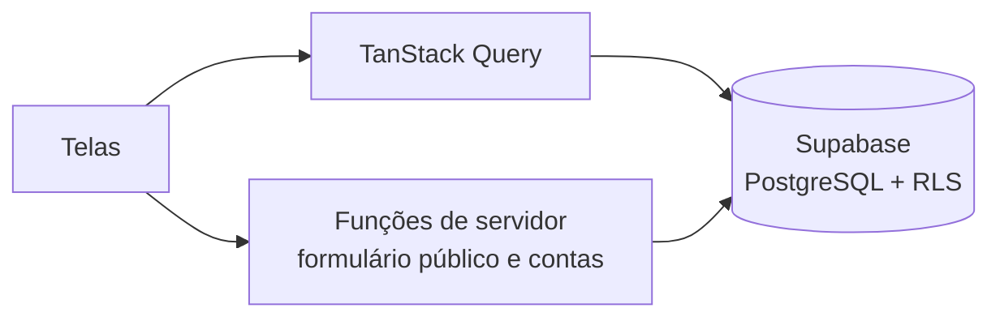
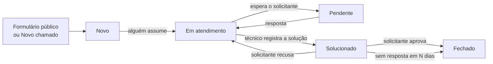
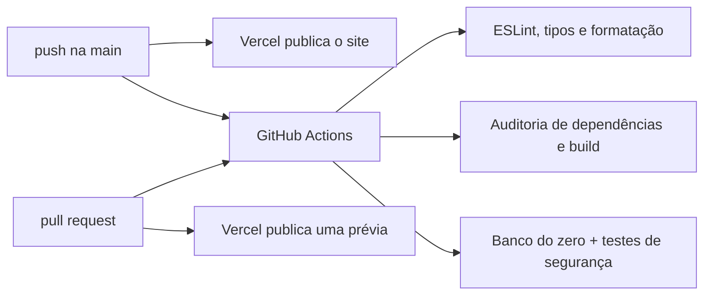

<div align="center">


# Central de Chamados · Atendimento de T.I.

**Suporte de T.I. para escritórios de contabilidade** · inspirado no GLPI

Sistema de gestão de chamados que uso para atender os escritórios de contabilidade que recebem meus serviços de T.I. Cada pedido entra com prazo, responsável e histórico, e a fila mostra primeiro o que está mais perto de estourar. Quem não tem conta abre chamado por um formulário público, mas só com o e-mail de uma empresa atendida.

[](https://centraldechamados-alpha.vercel.app)
[](https://github.com/higornovocardoso/Central-de-Chamados/actions/workflows/verificar.yml)
[](#tecnologias)
[](LICENSE)

[**Ver o site**](https://centraldechamados-alpha.vercel.app) · [LinkedIn](https://www.linkedin.com/in/higornovocardoso) · [GitHub](https://github.com/higornovocardoso)

</div>

---

## Sumário

- [Destaques](#destaques)
- [Capturas de tela](#capturas-de-tela)
- [Tecnologias](#tecnologias)
- [Estrutura do projeto](#estrutura-do-projeto)
- [Como funciona](#como-funciona)
- [Rodando localmente](#rodando-localmente)
- [Qualidade e automação](#qualidade-e-automação)
- [Segurança](#segurança)
- [Acessibilidade e desempenho](#acessibilidade-e-desempenho)
- [Licença](#licença)

## Destaques

- **Fila por prazo.** Cada prioridade tem um prazo para responder e outro para resolver, contados no horário comercial do calendário da empresa. O relógio para enquanto o chamado está _Pendente_ (esperando o solicitante), e a primeira resposta fica registrada.
- **Chamar próximo.** O painel mostra o chamado que você está atendendo, com o tempo que falta, e um botão que pega o próximo da fila pelo prazo mais apertado.
- **Formulário público fechado por domínio.** Quem não tem conta abre chamado sem login, mas só com o e-mail de uma empresa cadastrada. O domínio do e-mail decide de qual empresa é o chamado; domínio desconhecido é recusado com o motivo.
- **Várias empresas, cada uma isolada.** Um escritório nunca vê nem altera chamado, pessoa ou anexo de outro, e isso é garantido pelo banco, não só pela tela.
- **Atendimento completo.** Acompanhamentos públicos e privados, tarefas, solução com aprovação do solicitante, pedidos de aprovação, anexos e histórico de tudo o que mudou em cada chamado.
- **Quadro e agenda.** Chamados em colunas por status, arrastando de uma para outra, e as tarefas planejadas numa agenda.
- **Automação.** Regras de atribuição por critério (técnico, grupo, categoria), chamados recorrentes e fechamento automático dos solucionados, rodando no próprio banco.
- **Feito para o dia a dia.** Busca rápida com <kbd>Ctrl</kbd> <kbd>K</kbd>, tema escuro e claro (a escolha fica salva) e endereços com o nome de cada tela.

## Capturas de tela

| Chamados                                                                                    | Quadro                                                                           |
| ------------------------------------------------------------------------------------------- | -------------------------------------------------------------------------------- |
|  |  |

| Chamado                                                                                                                | Abrir chamado sem login                                                                                                  |
| ---------------------------------------------------------------------------------------------------------------------- | ------------------------------------------------------------------------------------------------------------------------ |
|  |  |

| Tema claro                                                         | Entrar                                                                                                                   |
| ------------------------------------------------------------------ | ------------------------------------------------------------------------------------------------------------------------ |
|  |  |

<p align="center">
  
</p>

## Tecnologias

| Camada             | Escolha                                                                                                                     | Por quê                                                                                             |
| ------------------ | --------------------------------------------------------------------------------------------------------------------------- | --------------------------------------------------------------------------------------------------- |
| Interface          | React 19 + TypeScript (`strict`) com [TanStack Start](https://tanstack.com/start) e TanStack Router                         | Telas renderizadas no servidor, rotas tipadas por arquivo e funções de servidor sem uma API à parte |
| Visual             | Tailwind CSS v4 com tokens próprios, componentes do [shadcn/ui](https://ui.shadcn.com) (Radix), fontes Geist e Lucide Icons | Tema claro e escuro a partir das mesmas variáveis; componentes acessíveis por teclado               |
| Dados no navegador | TanStack Query                                                                                                              | Cache, recarga em segundo plano e estados de carregamento sem código repetido                       |
| Banco e login      | [Supabase](https://supabase.com): PostgreSQL, Auth, RLS e pg_cron                                                           | As regras de acesso, os prazos e as automações ficam no próprio banco                               |
| Validação          | Zod                                                                                                                         | O mesmo esquema valida o formulário no navegador e a entrada no servidor                            |
| Build              | Vite e Nitro                                                                                                                | Um build gera o estático e a função de servidor da hospedagem                                       |
| Hospedagem         | [Vercel](https://vercel.com)                                                                                                | Publica sozinha a cada push na `main`, com prévia a cada pull request                               |
| Qualidade          | ESLint, Prettier, testes em SQL e GitHub Actions                                                                            | Lint, tipos, formatação, auditoria, build e testes do banco a cada push e pull request              |

## Estrutura do projeto

```text
.
├── src/
│   ├── routes/
│   │   ├── __root.tsx              # documento, tema antes da primeira pintura, 404 e tela de erro
│   │   ├── entrar.tsx              # login
│   │   ├── abrir-chamado.tsx       # formulário público, sem login
│   │   └── _authenticated/         # telas que exigem sessão
│   │       ├── painel.tsx          # indicadores, chamado em atendimento e "Chamar próximo"
│   │       ├── chamados.*.tsx      # lista, quadro, novo chamado e detalhe
│   │       ├── empresas.tsx        # empresas e domínios de e-mail do formulário público
│   │       ├── pessoas.*.tsx       # usuários e grupos
│   │       ├── prazos.*.tsx        # prazos por prioridade e calendários
│   │       └── …                   # categorias, perfis, regras, agenda, recorrentes, logs
│   ├── components/
│   │   ├── AppShell.tsx            # menu lateral, topo, menu do perfil e troca de tema
│   │   ├── CommandPalette.tsx      # busca rápida (Ctrl K)
│   │   └── ui/                     # componentes base do shadcn/ui
│   ├── lib/
│   │   ├── prazo.ts                # tempo restante e ordem da fila
│   │   ├── public-tickets.functions.ts  # função de servidor do formulário público
│   │   ├── users.functions.ts      # criar, editar e excluir contas (servidor)
│   │   ├── permissions.ts          # direitos de quem está logado
│   │   ├── theme.ts                # tema escuro e claro, com a transição em círculo
│   │   └── enderecos-antigos.ts    # endereços antigos que redirecionam para os novos
│   ├── integrations/supabase/      # clientes do navegador e do servidor e tipos do banco
│   └── server.ts                   # entrada do servidor: cabeçalhos de segurança e erros
├── supabase/
│   ├── migrations/                 # o banco inteiro, fase a fase: tabelas, gatilhos e RLS
│   └── tests/                      # testes de isolamento e de segurança, em SQL
├── scripts/testar-banco.sh         # recria o banco do zero e roda os testes
├── docs/telas/                     # capturas usadas neste README
├── .github/workflows/verificar.yml # lint, tipos, auditoria, build e banco a cada push
├── vite.config.ts                  # build, redirecionamentos e cache do estático
└── LICENSE                         # licença MIT
```

## Como funciona

### Do navegador ao banco



As telas leem e gravam direto no Supabase, com a sessão de quem está logado, e o RLS decide o que cada um vê. Duas coisas passam pelo servidor: o formulário público, que roda sem login, e criar, editar ou excluir contas, que exige a chave de serviço. Antes de mexer numa conta, o servidor pergunta ao banco se quem pediu pode mexer naquela conta.

### O caminho de um chamado



Ao nascer, o chamado passa por gatilhos no banco, sempre na mesma ordem: a proteção da abertura (quem não é da equipe não escolhe data, técnico nem fechamento), as regras de atribuição, a prioridade (urgência de quem abre cruzada com o impacto que a equipe ajusta), os prazos e, depois, a pausa em _Pendente_ e o registro da primeira resposta.

### Quem pode o quê

| Ação                                                             | Solicitante | Técnico | Supervisor | Administrador |
| ---------------------------------------------------------------- | :---------: | :-----: | :--------: | :-----------: |
| Abrir chamado e acompanhar os próprios                           |      ✓      |    ✓    |     ✓      |       ✓       |
| Aprovar ou recusar a solução do próprio chamado                  |      ✓      |    ✓    |     ✓      |       ✓       |
| Ver e atender os chamados das suas empresas                      |             |    ✓    |     ✓      |       ✓       |
| Registrar solução e tarefas                                      |             |    ✓    |     ✓      |       ✓       |
| Excluir chamados                                                 |             |         |     ✓      |       ✓       |
| Cadastrar pessoas, empresas, perfis, categorias, prazos e regras |             |         |            |       ✓       |

Os perfis seguem o GLPI (Self-Service, Técnico, Supervisor, Admin e Super-Admin) e cada direito é configurável na tela Perfis de acesso. Cada linha vale também no banco: esconder um botão nunca é a única proteção.

## Rodando localmente

Pré-requisitos: [Node.js](https://nodejs.org) 22 e um projeto no [Supabase](https://supabase.com).

1. Aplique as migrações de [`supabase/migrations/`](supabase/migrations) na ordem dos nomes, pelo [Supabase CLI](https://supabase.com/docs/guides/cli) (`supabase db push`) ou colando cada arquivo no SQL Editor.
2. Em **Authentication › Users**, crie o primeiro usuário. Ele vira Super-Admin automaticamente.
3. Em **Authentication › Sign In / Providers**, desative _Allow new users to sign up_: as contas são criadas pelo próprio sistema, na tela Pessoas.
4. Clone o projeto, configure o `.env` e rode:
   ```bash
   git clone https://github.com/higornovocardoso/Central-de-Chamados.git
   cd Central-de-Chamados
   cp .env.example .env    # preencha com a URL e as chaves do seu projeto Supabase
   npm install
   npm run dev             # abre em http://localhost:8080
   ```
5. Entre com o primeiro usuário. Em _Empresas_, cadastre cada escritório atendido e os domínios de e-mail que podem abrir chamado pelo formulário público.

O `.env` não é versionado. Ao publicar na Vercel, cadastre as mesmas variáveis no painel do projeto:

| Variável                        | Onde é lida | O que é                                                  |
| ------------------------------- | ----------- | -------------------------------------------------------- |
| `SUPABASE_URL`                  | Servidor    | URL do projeto                                           |
| `SUPABASE_PUBLISHABLE_KEY`      | Servidor    | Chave pública (publishable ou anon)                      |
| `SUPABASE_SERVICE_ROLE_KEY`     | Servidor    | Chave de serviço, só para criar, editar e excluir contas |
| `VITE_SUPABASE_URL`             | Navegador   | A mesma URL, embutida no código enviado ao navegador     |
| `VITE_SUPABASE_PUBLISHABLE_KEY` | Navegador   | A mesma chave pública, embutida no código                |

Tudo o que começa com `VITE_` fica visível para qualquer visitante. Só a chave pública pode ir ali; a chave de serviço nunca.

| Comando             | O que faz                                            |
| ------------------- | ---------------------------------------------------- |
| `npm run dev`       | Servidor de desenvolvimento                          |
| `npm run build`     | Build de produção para a Vercel                      |
| `npm run typecheck` | Verificação de tipos                                 |
| `npm run lint`      | Análise estática (ESLint)                            |
| `npm run test:db`   | Recria o banco do zero e roda os testes de segurança |

## Qualidade e automação



O teste do banco aplica todas as migrações num Postgres limpo e roda 26 cenários que tentam pela API o que a tela não oferece. Eles conferem, entre outras coisas, que:

- um usuário de uma empresa não lê nem grava chamado, local ou solução de outra, nem lendo a tabela inteira sem filtro;
- o formulário público só aceita domínios cadastrados, e mandar o id de outra empresa na requisição não adianta;
- quem abre chamado não consegue forjar data, técnico, prioridade travada ou fechamento, nem mandar textos gigantes;
- o sexto chamado do mesmo e-mail em 10 minutos é barrado;
- o solicitante aprova ou recusa a solução, mas não a reescreve nem registra uma solução no lugar do técnico;
- quem cuida das pessoas de uma empresa não mexe na conta do administrador, nem de outra empresa, nem se promove a Super-Admin.

## Segurança

O sistema passou por uma revisão de segurança que testou pela API tudo o que a tela impede. O que ficou valendo:

- **Regras no banco.** RLS em todas as tabelas, com isolamento por empresa, inclusive nas tabelas que pendem do chamado (acompanhamentos, soluções, aprovações, anexos). Gatilhos zeram os campos do sistema quando quem abre o chamado não é da equipe.
- **Contas.** Ninguém concede um perfil com mais direitos que o seu. Senha, e-mail e exclusão de conta só passam depois de o banco confirmar que quem pediu pode mexer naquela conta.
- **Formulário público.** Só domínios cadastrados, conferidos no servidor e de novo no banco; limite de 5 chamados por e-mail e 60 no total a cada 10 minutos; campo-armadilha contra robôs.
- **Segredos.** A chave de serviço existe só no servidor. O `.env` não é versionado, e só a chave pública vai para o navegador.
- **Site.** Toda resposta sai com `Content-Security-Policy`, HSTS, `X-Frame-Options`, `nosniff`, `Referrer-Policy` e `Permissions-Policy`. As dependências passam por auditoria a cada push.

## Acessibilidade e desempenho

- **Carregamento.** As telas são renderizadas no servidor e cada rota baixa só o próprio código. Os arquivos estáticos ficam em cache por um ano.
- **Tema sem piscar.** A escolha entre escuro e claro é aplicada antes da primeira pintura e continua valendo ao recarregar.
- **Menos movimento.** Com "reduzir movimento" ativado no sistema, animações e transições são desligadas.
- **Teclado.** Foco visível em tudo que é clicável, busca rápida com <kbd>Ctrl</kbd> <kbd>K</kbd> e janelas que fecham com <kbd>Esc</kbd>.
- **Celular.** Todas as telas funcionam no celular, com menu lateral recolhível.

## Licença

Distribuído sob a licença MIT. Veja [`LICENSE`](LICENSE) para mais detalhes.

O nome GLPI pertence ao seu projeto, e o conteúdo pessoal (textos, nomes e imagens) não está coberto pela licença.

---

<div align="center">
Feito por <a href="https://www.linkedin.com/in/higornovocardoso">Higor Cardoso</a> · Garopaba, SC
</div>
